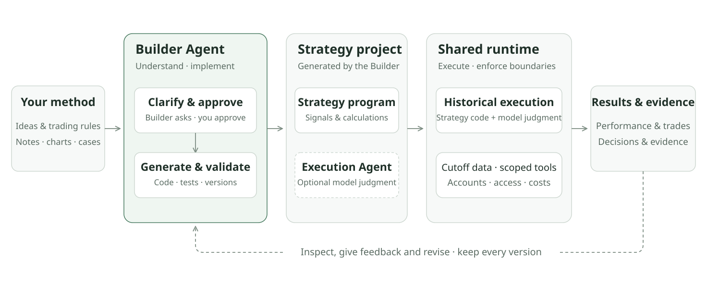

# Strategy Agent Lab

[English](README.md) | [简体中文](README.zh-CN.md)

### Turn your investment method into a testable strategy.

Start with an investment idea, your own rules, or examples from your notes and charts. The Builder Agent asks questions to make the rules clear, then turns your approved method into strategy code and tests. Run it on historical data, inspect what it did, and refine it in the same conversation.

**[Online demo](https://xxiao053.github.io/strategy-agent-lab/)** · **[Run locally](#quick-start)** · **[Documentation](#documentation)** · **[Watch the walkthrough](docs/media/walkthrough.mp4)**


The video is edited playback of real saved records, with English and Chinese captions. Browsing these examples makes no model calls.

## A workbench for building strategies

You bring the idea and decide the rules. The Builder helps turn them into a strategy you can run, inspect and change. If your method needs model judgment as well as calculations, the strategy can include an Execution Agent.

- Clarify a method in English or Chinese, approve immutable versions and revise without overwriting earlier work.
- Import text, Markdown, CSV, text-extractable PDF and PNG/JPEG examples with inspectable source references.
- Search model catalogs or enter a model ID; configure builder and execution roles independently with your own credentials.
- Generate and test standard-library Python projects in restricted Docker workers or native Windows MXC.
- Run compatible projects on frozen US stock/ETF daily data. Inspect equity, trades, holdings and dated model evidence, then bring a decision back into the conversation.
- Browse packaged conversations, generated files, tests and run results without credentials or a private database; create an independent editable copy in the local application.

Generated self-tests are reports from the generated project, not independent proof of correctness. The workbench is not a live-trading service, an autonomous strategy optimizer or a guarantee of investment performance.

## How it works

<picture>
  <source media="(prefers-color-scheme: dark)" srcset="docs/media/workflow-en-dark.svg">
  
</picture>

Want to change something? Continue the conversation and build a new version. Earlier methods, code and results stay available.

You decide what the strategy should do; the workbench helps you check whether it does it. For the technical responsibilities and execution boundaries, see [Architecture](docs/en/architecture.md).

## Quick start

Install and start Docker with Linux containers. From the downloaded repository:

Windows:

```powershell
.\scripts\start-docker.cmd
```

macOS / Linux:

```sh
sh scripts/start-docker.sh
```

Open **[localhost:8765](http://127.0.0.1:8765)**.

1. Explore the included projects without an API key. Use **Create editable copy** to start from an example, or **New project** for your own method.
2. Configure your credentials in **Model settings** and assign the project's model roles.
3. Clarify and approve the method, then **Build and validate**. Prepare market data separately before a historical run.

Live model tasks require your own credentials and spending authorization. Startup and browsing do not call models; the initial build downloads dependencies. The controller and generated-code workers run in separate containers.

Windows Docker Desktop has undergone scoped application, worker and fresh-volume acceptance. Linux/macOS scripts are supplied but have **not** been platform-accepted. See [Docker setup, persistence and trust boundaries](docs/en/docker-local.md). Native Windows development is also available through [Getting started](docs/en/getting-started.md).

## Explore real examples

| Example | What it demonstrates |
| --- | --- |
| Complete cup-and-handle Builder project | Full method → clarification → generated implementation → 40 instruments and 718 historical sessions; independent implementation, cutoff and accounting checks |
| NVDA revision | A Chinese instruction changes fixed sizing from 100 to 50 shares; both method versions, implementations and historical runs remain inspectable |
| Original cup execution example | The separately preserved method-specific workflow, with its original configuration and saved results |

[](docs/en/demonstration.md)

The primary generated run covers **2024-01-02–2026-11-10**, starts at $100,000 and ends at **$176,188.30**: **+76.19% return, 36.14% maximum daily-close drawdown**, including simulated fees and slippage. These are historical example results, not expected returns. The original example is not relabeled as Builder output. See the [scope, configuration and limitations](docs/en/demonstration.md).

## Local application and online showcase

| | Local application | Static showcase |
| --- | --- | --- |
| Purpose | Create, build, run and revise projects | Inspect packaged projects and media |
| Model access | Your credentials; authorized calls | None |
| Backend | Local controller and isolated workers | Static files only |
| Continue an example | Create an editable copy | Read-only |

The local application uses the operator's own model credentials and spending authorization; it supplies no author account or allowance. OpenAI is live-tested for the demonstrated workflows. Other provider adapters are offline-tested extension points, not verified substitutes for every coding or image capability.

A separate static showcase shares the saved-project viewer and packaged examples. It supports navigation, code inspection, results and media without a Python backend. It cannot start new conversations, builds or historical runs. **[Open the online workbench](https://xxiao053.github.io/strategy-agent-lab/)**, hosted for free on GitHub Pages. See the [preview and publishing guide](docs/en/github-pages.md). No hosted live backend is planned.

## Try it, make it yours, and share what you learn

You're welcome to try the workbench, use it for your own methods, fork it and change it. If you find something useful, build a variation or have an idea for improvement, I'd love to hear about it—open an issue or share a pull request on GitHub. Feedback and a note about what you've built are appreciated, not required by the license.

For changes, see the [development guide](docs/en/development.md). Please keep API keys, personal trading records and private materials out of public issues and pull requests.

## Documentation

[Product scope](docs/en/product-direction.md) · [Getting started](docs/en/getting-started.md) · [Architecture](docs/en/architecture.md) · [Models and costs](docs/en/models.md) · [Materials](docs/en/materials.md) · [Security and limitations](docs/en/security.md) · [Development](docs/en/development.md)

Initial execution scope is Python, daily long-only US stocks/ETFs and the validated local data catalog. No broker connections, live orders, hosted multiuser accounts or arbitrary dependencies are included. See the [strategy-v1 contract](docs/en/execution-contract.md).

## License

Original software and documentation are available under the [MIT License](LICENSE), copyright © 2026 xxiao053. Third-party software retains its [own licenses and notices](THIRD_PARTY_NOTICES.txt). Market data, referenced publications and third-party content shown in media are not licensed by MIT; see the [data and reference-material notice](DATA_NOTICE.md).
