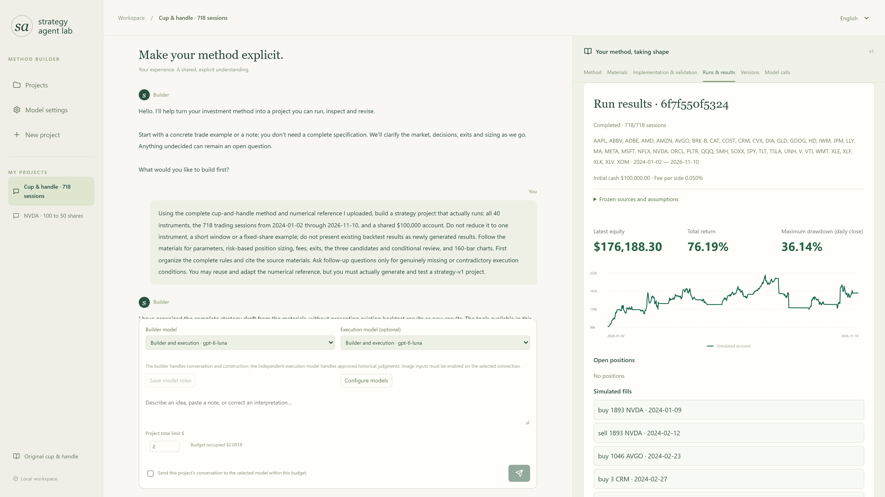
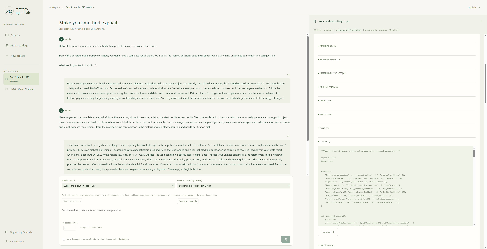
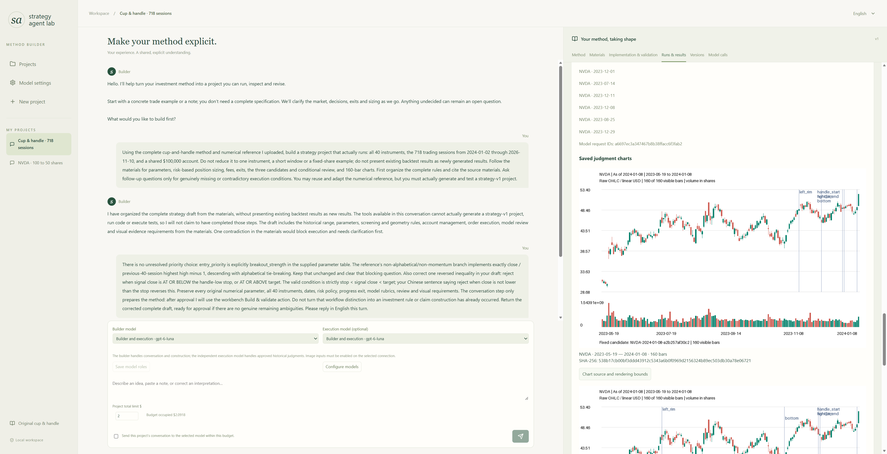
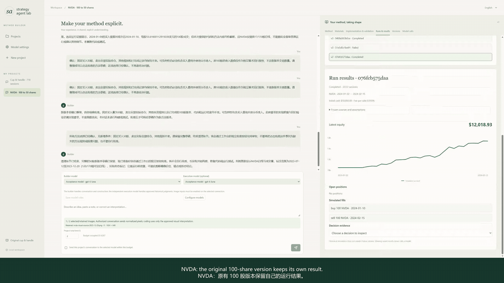
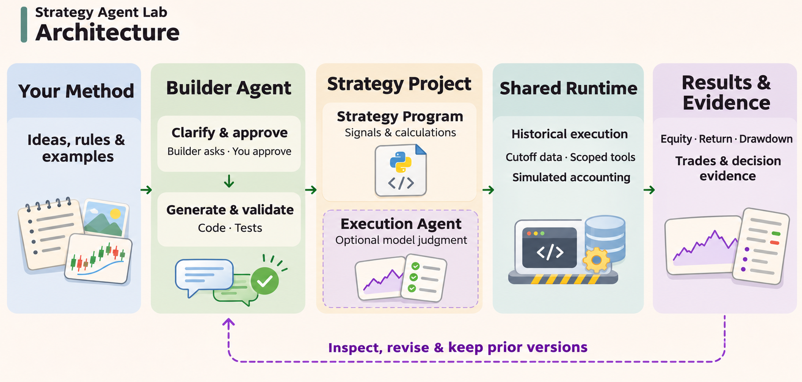

<h1 align="center">Strategy Agent Lab</h1>

<p align="center"><strong>English</strong> · <a href="README.zh-CN.md">简体中文</a></p>

<h3 align="center">Turn your investment method into a testable strategy.</h3>

<p align="center">Describe your investment method to the Builder Agent. It turns the rules you approve into testable Python code and, when your strategy needs model judgment, <strong>builds a second agent to apply your rules during historical runs</strong>.</p>

<p align="center">
  <a href="https://xxiao053.github.io/strategy-agent-lab/"></a>
  <a href="https://github.com/xxiao053/strategy-agent-lab/actions/workflows/ci.yml"></a>
  <a href="LICENSE"></a>
</p>

<p align="center"><a href="#walkthrough">Walkthrough</a> · <a href="#quick-start">Run locally</a> · <a href="#how-it-works">Architecture</a> · <a href="#documentation">Documentation</a></p>

<p align="center">
  <a href="https://xxiao053.github.io/strategy-agent-lab/"></a>
</p>

<a name="walkthrough"></a>

## 🎥 Walkthrough

https://github.com/user-attachments/assets/b51d49c6-d592-4613-8d59-c11fb458bf88

A replay of real project records with English and Chinese captions. [Open the MP4](docs/media/walkthrough.mp4) if the player is unavailable.

## ✨ Highlights

### Turn your rules into code, tests, and an optional Execution Agent

Give the Builder Agent your rules, notes, or chart examples in English or Chinese. Once you approve the method, it generates the strategy code and tests. If your strategy needs judgment—for example, deciding whether a chart matches a pattern—the Builder also creates an **Execution Agent** with criteria to apply and evidence it can inspect. [See supported materials.](docs/en/materials.md)



### See why the strategy made a decision

During a historical run, the system supplies the Execution Agent with evidence available as of each decision date. Review its recorded judgments and supporting evidence alongside equity, return, drawdown, trades and holdings.



### Change a rule and keep the previous version

In the NVDA example, a follow-up changes fixed sizing from **100 to 50 shares**. Both method versions, implementations and historical runs remain available to compare.

[](docs/en/demonstration.md)

<a name="how-it-works"></a>

## 🧩 How it works



The Builder creates a strategy project. The shared runtime runs it on historical data, enforces information cutoffs and handles simulated accounting. See the [architecture and execution boundaries](docs/en/architecture.md).

<details>
<summary>Original architecture diagram</summary>

<picture>
  <source media="(prefers-color-scheme: dark)" srcset="docs/media/workflow-en-dark.svg">
  
</picture>

</details>

<a name="quick-start"></a>

## 🚀 Quick start

Install and start Docker with Linux containers. From the downloaded repository:

Windows:

```powershell
.\scripts\start-docker.cmd
```

macOS / Linux:

```sh
sh scripts/start-docker.sh
```

Open **[localhost:8765](http://127.0.0.1:8765)**.

1. Explore the included projects without an API key. Use **Create editable copy** to start from an example, or **New project** for your own method.
2. Configure your credentials in **Model settings** and assign the project's model roles.
3. Clarify and approve the method, then **Build and validate**. Prepare market data separately before a historical run.

Startup and browsing do not call models. Live model tasks use your own credentials and spending authorization; the Builder and Execution Agent can use different model connections. See [models and costs](docs/en/models.md).

The initial build downloads dependencies. Docker Desktop has been tested on Windows; the macOS and Linux startup scripts are provided but have not been tested end to end on those hosts. See [Docker setup](docs/en/docker-local.md) or [native Windows setup](docs/en/getting-started.md).

## 🎬 Explore real examples

| Example | What it demonstrates |
| --- | --- |
| Complete cup-and-handle Builder project | Follow the approved method through generated code and tests to a run across 40 instruments and 718 trading sessions |
| NVDA revision | Follow a rule change requested in Chinese and compare two versions of the same strategy |
| Original cup execution example | The separately preserved method-specific workflow, with its original configuration and saved results |

The complete Builder example covers **2024-01-02–2026-11-10**. Its simulated account starts at $100,000 and ends at **$176,188.30**: **+76.19% total return** and **36.14% maximum daily-close drawdown**, including simulated fees and slippage. These are historical results, not expected returns. See the [method, run assumptions and verification](docs/en/demonstration.md).

## 💻 Local application and online demo

| | Local application | Static showcase |
| --- | --- | --- |
| Purpose | Create, build, run and revise projects | Inspect packaged projects and media |
| Model access | Your credentials; authorized calls | None |
| Backend | Local controller and isolated workers | Static files only |
| Continue an example | Create an editable copy | Read-only |

The [online demo](https://xxiao053.github.io/strategy-agent-lab/) is hosted on GitHub Pages. It lets you inspect saved conversations, code and runs without a key. Run the app locally to create projects or continue an example. OpenAI has been tested in the demonstrated live workflows; check [provider support](docs/en/models.md) before choosing another provider.

## 🤝 Try it, make it yours, and share what you learn

You're welcome to try the workbench, use it for your own methods, fork it and change it. If you find something useful, build a variation or have an idea for improvement, I'd love to hear about it—open an issue or share a pull request on GitHub. Feedback and a note about what you've built are appreciated, not required by the license.

For changes, see the [development guide](docs/en/development.md). Please keep API keys, personal trading records and private materials out of public issues and pull requests.

<a name="documentation"></a>

## 📚 Documentation

[Product scope](docs/en/product-direction.md) · [Getting started](docs/en/getting-started.md) · [Architecture](docs/en/architecture.md) · [Models and costs](docs/en/models.md) · [Materials](docs/en/materials.md) · [Security and limitations](docs/en/security.md) · [Development](docs/en/development.md)

Execution currently supports Python strategies on daily long-only US stocks/ETFs using the validated local data catalog. There are no broker connections, live orders, hosted accounts or arbitrary dependencies. Generated self-tests are not independent proof of correctness. See the [strategy-v1 contract](docs/en/execution-contract.md).

## 📄 License

Original software and documentation are available under the [MIT License](LICENSE), copyright © 2026 xxiao053. Third-party software retains its [own licenses and notices](THIRD_PARTY_NOTICES.txt). Market data, referenced publications and third-party content shown in media are not licensed by MIT; see the [data and reference-material notice](DATA_NOTICE.md).
