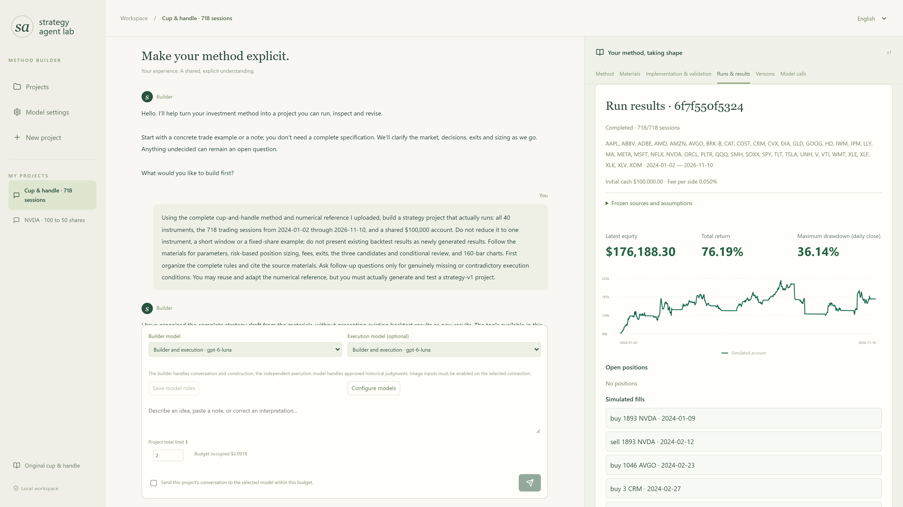
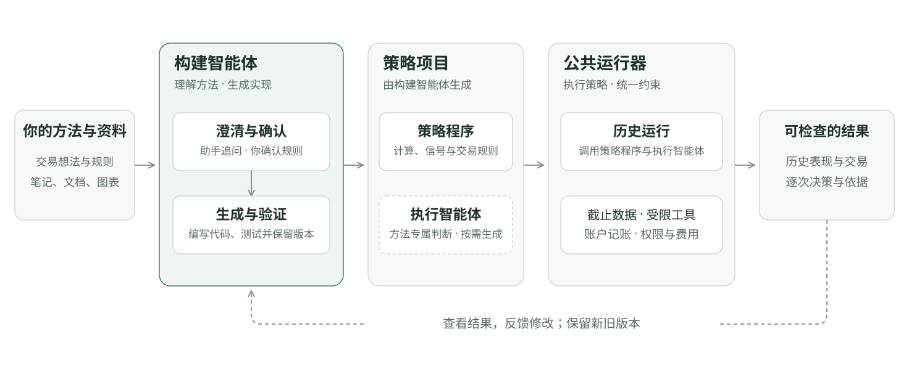

# Strategy Agent Lab

[English](https://github.com/xxiao053/strategy-agent-lab#readme) | **简体中文**

### 把你的投资方法，变成可验证的策略项目。

从一个投资想法、自己的交易规则，或笔记和图表案例开始。构建助手会追问不清楚的地方，把你确认的方法写成策略代码并测试。你可以用历史数据运行它，检查它做了什么，再在同一段对话中继续修改。

[](https://xxiao053.github.io/strategy-agent-lab/)
[](https://github.com/xxiao053/strategy-agent-lab/actions/workflows/ci.yml)
[](LICENSE)

**[本地运行](#快速开始)** · **[文档](#文档)** · **[演示视频](docs/media/walkthrough.mp4)**



视频是已保存真实记录的剪辑回放，配中英文字幕。浏览示范不会产生模型调用。

## 用于构建策略的工作台

你提供想法、决定规则；构建助手帮你做成可以运行、检查和修改的策略。如果方法除了计算还需要模型判断，策略也可以包含执行智能体。

- 用中文或英文澄清方法，确认不可覆盖的版本；修改后保留以前的工作。
- 导入文字、Markdown、CSV、文字型 PDF 和 PNG/JPEG 案例，检查引用来源。
- 搜索模型目录或手动填写模型；使用自己的凭据，分别配置构建与执行角色。
- 在受限 Docker 工作容器或原生 Windows MXC 中生成、测试标准库 Python 项目。
- 使用冻结的美股／ETF 日频数据运行兼容项目，查看权益、交易、持仓和带日期的判断依据，再将某次决策引用回对话。
- 无需密钥或私人数据库，浏览打包的真实对话、生成文件、测试与运行结果；在本地应用中创建独立可编辑副本。

生成项目的自测是它自己提供的报告，不是独立正确性证明。工作台不是实盘交易服务、自动策略寻优工具或投资收益保证。

## 工作方式

<picture>
  <source media="(prefers-color-scheme: dark)" srcset="docs/media/workflow-zh-dark.svg">
  
</picture>

想调整规则？回到同一段对话继续修改，生成新版本；之前的方法、代码和结果仍然保留。

你决定策略应该做什么，工作台帮助你检查它是否按你的意思执行。技术分工和运行边界另见[系统设计](docs/zh-CN/architecture.md)。

## 快速开始

安装并启动 Docker，使用 Linux 容器。在下载的项目目录中执行：

Windows：

```powershell
.\scripts\start-docker.cmd
```

macOS / Linux：

```sh
sh scripts/start-docker.sh
```

打开 **[localhost:8765](http://127.0.0.1:8765)**。

1. 无需 API 密钥即可浏览随附项目。使用“创建可编辑副本”从案例开始，或“新建项目”实现自己的方法。
2. 在“模型设置”中配置自己的凭据，并为项目分配模型角色。
3. 澄清并确认方法，再“构建并验证”。历史运行前需要另行准备行情数据。

实时模型任务需要你自己的凭据和费用授权。启动和浏览不会调用模型；首次构建需要下载依赖。后台和生成代码分别运行在不同容器中。

Windows Docker Desktop 已接受应用、工作容器及全新数据卷等分项验收。提供了 Linux/macOS 启动脚本，但**尚未完成这些平台的实际验收**。见 [Docker 启动、持久化与权限边界](docs/zh-CN/docker-local.md)；原生 Windows 开发方式见[开始使用](docs/zh-CN/getting-started.md)。

## 查看真实案例

| 案例 | 展示内容 |
| --- | --- |
| 完整杯柄构建项目 | 完整方法 → 澄清 → 生成实现 → 40 个标的、718 个历史交易日；另有实现、数据截止和账户核验 |
| NVDA 修改案例 | 中文指令把固定仓位从 100 股改为 50 股；两个方法版本、实现和历史运行都可查看 |
| 原始杯柄执行示范 | 独立保留的专用执行流程、原配置及原结果 |

[](docs/zh-CN/demonstration.md)

主要构建项目覆盖 **2024-01-02–2026-11-10**，模拟账户从 $100,000 到 **$176,188.30**：**累计收益 +76.19%，最大日收盘回撤 36.14%**，已计模拟手续费和滑点。这是历史示范结果，不是预期收益；原始案例没有被改称为构建助手的产出。见[范围、配置和限制](docs/zh-CN/demonstration.md)。

## 本地应用与在线展示

| | 本地应用 | 静态展示版 |
| --- | --- | --- |
| 用途 | 创建、构建、运行与修改项目 | 检查打包的项目与媒体 |
| 模型访问 | 使用你自己的凭据，经授权后调用 | 无 |
| 后台 | 本地后台与隔离工作环境 | 仅静态文件 |
| 继续修改案例 | 创建可编辑副本 | 只读 |

本地应用使用操作者自己的模型凭据与费用授权，不提供作者的账户或额度。已用 OpenAI 实测所展示的流程；其他供应商适配器经过离线测试，是扩展接口，不代表已验证所有编码或图片能力。

独立静态展示版复用项目查看界面和示范包，无需 Python 后台即可浏览页面、代码、结果和视频。它不能发起新对话、构建或历史运行。**[打开在线工作台](https://xxiao053.github.io/strategy-agent-lab/)**，由 GitHub Pages 免费托管；预览和更新方式见[发布指南](docs/zh-CN/github-pages.md)。本阶段不提供在线实时模型后台。

## 欢迎尝试、修改，也欢迎告诉我你的想法

欢迎试用工作台，用它实现自己的方法，也欢迎 Fork、修改和扩展。如果你发现了有用的功能、做出了自己的版本，或有任何改进建议，很欢迎通过 GitHub Issue 或 Pull Request 告诉我。交流和分享使用情况是友好的邀请，不是许可证附加要求。

参与修改可参考[开发说明](docs/zh-CN/development.md)。请不要在公开 Issue 或 Pull Request 中附上 API 密钥、个人交易记录或私有材料。

## 文档

[产品范围](docs/zh-CN/product-direction.md) · [开始使用](docs/zh-CN/getting-started.md) · [系统设计](docs/zh-CN/architecture.md) · [模型与费用](docs/zh-CN/models.md) · [资料导入](docs/zh-CN/materials.md) · [安全与限制](docs/zh-CN/security.md) · [开发说明](docs/zh-CN/development.md)

初始执行范围为 Python、美股／ETF、日频、现货只做多及经过验证的本地行情目录。不包含券商连接、实盘下单、托管多用户账户或任意依赖安装。见 [strategy-v1 执行约定](docs/zh-CN/execution-contract.md)。

## 许可证

原创软件和文档采用 [MIT 许可证](LICENSE)，版权署名为 © 2026 xxiao053。第三方软件保留[各自的许可证与声明](THIRD_PARTY_NOTICES.txt)。行情数据、参考文献及媒体中的第三方内容不由 MIT 授权，详见[数据与参考资料说明](DATA_NOTICE.zh-CN.md)。
