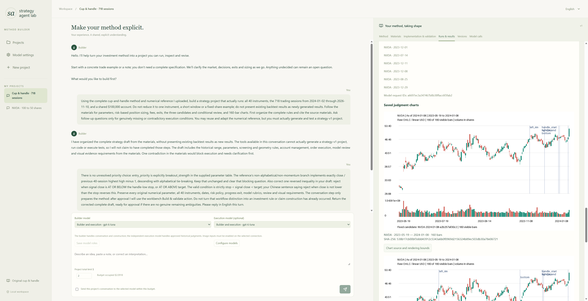
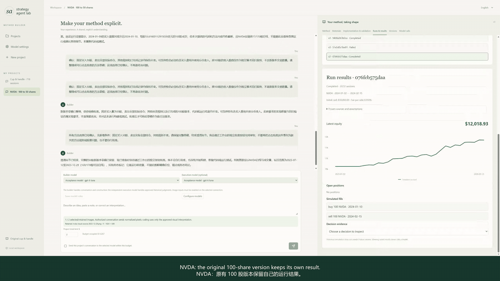
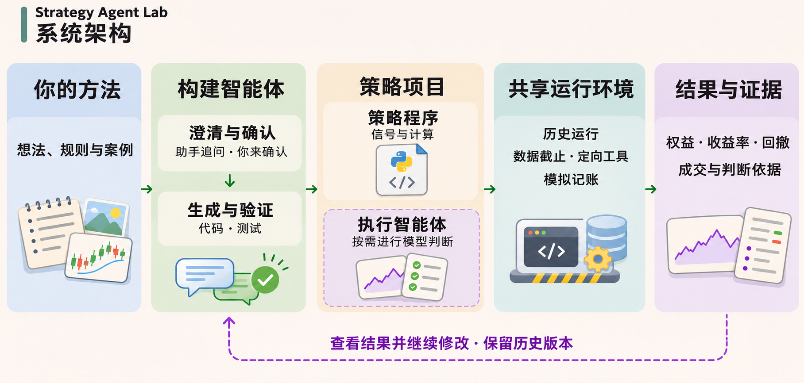

<h1 align="center">Strategy Agent Lab</h1>

<p align="center"><a href="https://github.com/xxiao053/strategy-agent-lab#readme">English</a> · <strong>简体中文</strong></p>

<h3 align="center">把你的投资方法，变成可验证的策略项目。</h3>

<p align="center">从一个想法、一套规则或一张标注图表开始。构建智能体帮你理清方法，把你确认的规则写成 Python 策略代码，方便测试、用历史数据运行，再继续修改。</p>

<p align="center">
  <a href="https://xxiao053.github.io/strategy-agent-lab/"></a>
  <a href="https://github.com/xxiao053/strategy-agent-lab/actions/workflows/ci.yml"></a>
  <a href="LICENSE"></a>
</p>

<p align="center"><a href="#walkthrough">演示视频</a> · <a href="#start">本地运行</a> · <a href="#architecture">系统设计</a> · <a href="#docs">文档</a></p>

<p align="center">
  <a href="https://xxiao053.github.io/strategy-agent-lab/"></a>
</p>

<a name="walkthrough"></a>

## 🎥 演示视频

https://github.com/user-attachments/assets/b51d49c6-d592-4613-8d59-c11fb458bf88

真实项目记录的回放，配中英文字幕。如果播放器不可用，可[打开 MP4 文件](docs/media/walkthrough.mp4)。

## ✨ 产品亮点

### 把规则写成代码和测试

可以用中文或英文提供笔记、文件或图表案例。构建智能体追问不清楚的地方，由你确认规则，然后生成并测试 Python 实现。[查看支持的资料格式。](docs/zh-CN/materials.md)


### 查看策略为什么这样判断

除了权益、累计收益率、最大回撤、成交和持仓，还可以查看每次模型判断的依据。策略确实需要模型判断时，才由执行智能体根据已确认规则和当时可用的信息作出判断。



### 修改一条规则，保留旧版本

NVDA 案例里，一条后续指令把固定仓位从 **100 股改为 50 股**。两个版本的方法、代码和历史运行都可以对照查看。

[](docs/zh-CN/demonstration.md)

<a name="architecture"></a>
<a name="工作方式"></a>

## 🧩 工作方式



构建智能体产出策略项目。共享运行环境用历史数据运行项目，限制每个时点可使用的信息，并负责模拟记账。详见[系统设计与执行边界](docs/zh-CN/architecture.md)。

<details>
<summary>查看原版中文架构图</summary>

<picture>
  <source media="(prefers-color-scheme: dark)" srcset="docs/media/workflow-zh-dark.svg">
  
</picture>

</details>

<a name="start"></a>
<a name="快速开始"></a>

## 🚀 快速开始

安装并启动 Docker，使用 Linux 容器。在下载的项目目录中执行：

Windows：

```powershell
.\scripts\start-docker.cmd
```

macOS / Linux：

```sh
sh scripts/start-docker.sh
```

打开 **[localhost:8765](http://127.0.0.1:8765)**。

1. 无需 API 密钥即可浏览随附项目。使用“创建可编辑副本”从案例开始，或“新建项目”实现自己的方法。
2. 在“模型设置”中配置自己的凭据，并为项目分配模型角色。
3. 澄清并确认方法，再“构建并验证”。历史运行前需要另行准备行情数据。

启动和浏览不会调用模型。实时模型任务使用你自己的凭据，并须授权费用；构建和执行可以分别配置模型。详见[模型与费用](docs/zh-CN/models.md)。

首次构建需要下载依赖。Docker Desktop 已在 Windows 上测试；macOS 和 Linux 提供启动脚本，尚未在这两个平台完成端到端测试。参见 [Docker 启动说明](docs/zh-CN/docker-local.md)或[原生 Windows 启动说明](docs/zh-CN/getting-started.md)。

## 🎬 查看真实案例

| 案例 | 展示内容 |
| --- | --- |
| 完整杯柄构建项目 | 从确认的方法、生成的代码与测试，到覆盖 40 个标的、718 个交易日的历史运行 |
| NVDA 修改案例 | 查看一条中文指令如何修改规则，并对照同一策略的两个版本 |
| 原始杯柄执行示范 | 独立保留的专用执行流程、原配置及原结果 |

完整杯柄项目覆盖 **2024-01-02–2026-11-10**。模拟账户从 $100,000 到 **$176,188.30**：**累计收益 +76.19%，最大日收盘回撤 36.14%**，已计模拟手续费和滑点。这是历史结果，不是预期收益。见[方法、运行假设和核验](docs/zh-CN/demonstration.md)。

## 💻 本地应用与在线演示

| | 本地应用 | 静态展示版 |
| --- | --- | --- |
| 用途 | 创建、构建、运行与修改项目 | 检查打包的项目与媒体 |
| 模型访问 | 使用你自己的凭据，经授权后调用 | 无 |
| 后台 | 本地后台与隔离工作环境 | 仅静态文件 |
| 继续修改案例 | 创建可编辑副本 | 只读 |

[在线演示](https://xxiao053.github.io/strategy-agent-lab/)由 GitHub Pages 托管，无需密钥即可查看已保存的对话、代码和运行结果。新建项目或继续修改案例，请使用本地应用。演示中的实时模型流程已用 OpenAI 测试；选用其他供应商前，请查看[支持范围](docs/zh-CN/models.md)。

## 🤝 欢迎尝试、修改，也欢迎告诉我你的想法

欢迎试用工作台，用它实现自己的方法，也欢迎 Fork、修改和扩展。如果你发现了有用的功能、做出了自己的版本，或有任何改进建议，很欢迎通过 GitHub Issue 或 Pull Request 告诉我。交流和分享使用情况是友好的邀请，不是许可证附加要求。

参与修改可参考[开发说明](docs/zh-CN/development.md)。请不要在公开 Issue 或 Pull Request 中附上 API 密钥、个人交易记录或私有材料。

<a name="docs"></a>
<a name="文档"></a>

## 📚 文档

[产品范围](docs/zh-CN/product-direction.md) · [开始使用](docs/zh-CN/getting-started.md) · [系统设计](docs/zh-CN/architecture.md) · [模型与费用](docs/zh-CN/models.md) · [资料导入](docs/zh-CN/materials.md) · [安全与限制](docs/zh-CN/security.md) · [开发说明](docs/zh-CN/development.md)

当前支持 Python 策略，使用经过验证的本地美股／ETF 日频行情，现货只做多。不包含券商连接、实盘下单、云端账户或任意依赖安装。生成项目的自测不构成独立正确性证明。见 [strategy-v1 执行约定](docs/zh-CN/execution-contract.md)。

## 📄 许可证

原创软件和文档采用 [MIT 许可证](LICENSE)，版权署名为 © 2026 xxiao053。第三方软件保留[各自的许可证与声明](THIRD_PARTY_NOTICES.txt)。行情数据、参考文献及媒体中的第三方内容不由 MIT 授权，详见[数据与参考资料说明](DATA_NOTICE.zh-CN.md)。
